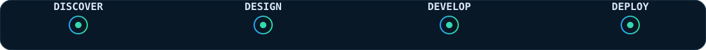
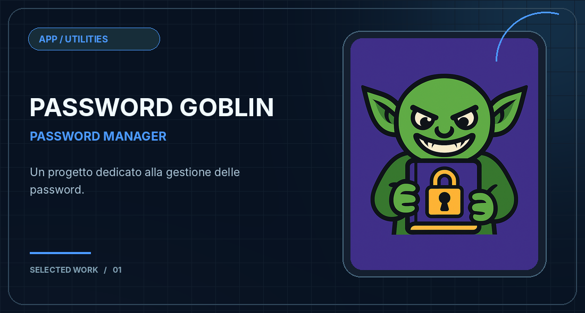
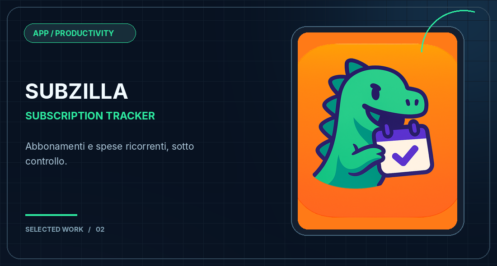
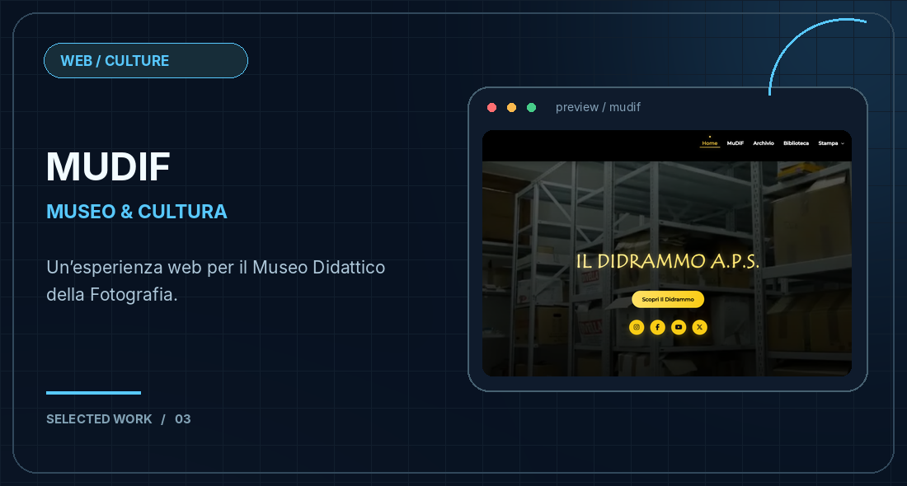
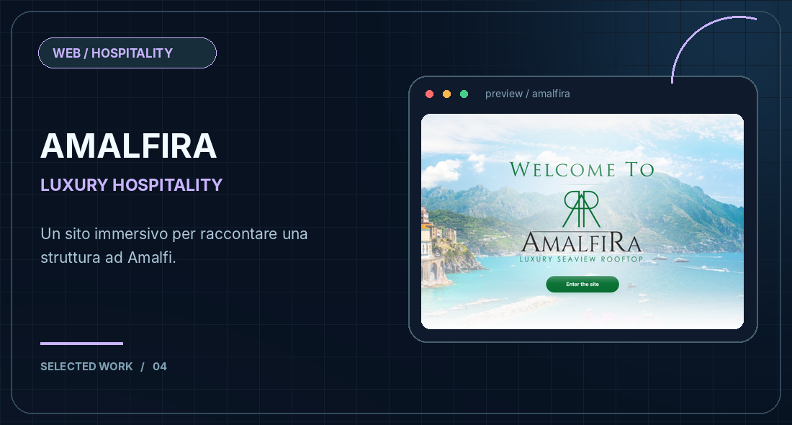

<!-- Marco Amantea — GitHub profile | Assets local, light/dark, motion-sensitive. -->

  <picture>
    <source media="(prefers-color-scheme: dark)" srcset="./assets/hero-dark.svg" />
    <source media="(prefers-color-scheme: light)" srcset="./assets/hero-light.svg" />
    
  </picture>

  
  
  

  Frontend development · Web experiences · User-centered design

 

  <a href="#about">About</a> &nbsp;·&nbsp;
  <a href="#selected-work">Selected work</a> &nbsp;·&nbsp;
  <a href="#toolbox">Toolbox</a> &nbsp;·&nbsp;
  <a href="#github-activity">GitHub activity</a> &nbsp;·&nbsp;
  <a href="#contact">Contact</a>

---

## 01 / Beyond the code

**Progetto esperienze digitali in cui design e sviluppo parlano la stessa lingua.**

Sono **Marco Amantea**, Web Developer & Web Designer. Trasformo idee in interfacce curate, intuitive e performanti: dalla progettazione dell'esperienza fino allo sviluppo di siti web e applicazioni.

Mi interessano il dettaglio visivo, la qualità del codice, l'accessibilità e soprattutto il modo in cui le persone **vivono** un prodotto digitale.

<table>
  <tr>
    <td width="33%" valign="top"><strong>01 — Design</strong>  UI/UX, responsive layout, design system e identità visiva.</td>
    <td width="33%" valign="top"><strong>02 — Development</strong>  Frontend moderne, componenti riutilizzabili e web app.</td>
    <td width="33%" valign="top"><strong>03 — Experience</strong>  Interazioni, accessibilità, performance e cura dei dettagli.</td>
  </tr>
</table>

  <picture>
    <source media="(prefers-color-scheme: dark)" srcset="./assets/process-dark.svg" />
    <source media="(prefers-color-scheme: light)" srcset="./assets/process-light.svg" />
    
  </picture>

  
<strong>+ Come affronto un progetto — apri il mio workflow</strong>

   

  | Fase | Obiettivo | Risultato |
  | :--- | :--- | :--- |
  | **Discover** | Capire persone, esigenze e contesto | Obiettivi e struttura |
  | **Design** | Dare forma all'esperienza | Interfaccia e direzione visiva |
  | **Develop** | Trasformare il design in prodotto | Componenti e funzionalità |
  | **Refine** | Testare e rifinire i dettagli | Esperienza più solida e fluida |

---

## 02 / Selected work

Una selezione di prodotti digitali e progetti web già presenti nel mio portfolio.

<table>
  <tr>
    <td width="50%" valign="top">
      
      <h3>Password Goblin</h3>
      
App dedicata alla gestione delle password.

      <a href="https://play.google.com/store/apps/details?id=com.subzillamark.passwordgoblin&amp;hl=it">Esplora su Google Play →</a>
    </td>
    <td width="50%" valign="top">
      
      <h3>Subzilla</h3>
      
App per organizzare e monitorare gli abbonamenti.

      <a href="https://play.google.com/store/apps/details?id=com.ienashow.abbonamentiapp">Esplora su Google Play →</a>
    </td>
  </tr>
  <tr>
    <td width="50%" valign="top">
      
      <h3>MuDiF / Il Didrammo APS</h3>
      
Esperienza web per il Museo Didattico della Fotografia e la sua associazione.

      <a href="https://ildidrammo.com/home">Visita il sito →</a>
    </td>
    <td width="50%" valign="top">
      
      <h3>AmalfiRa Luxury Seaview Rooftop</h3>
      
Un sito immersivo dedicato all'ospitalità e alla Costiera Amalfitana.

      <a href="https://amalfiraluxuryseaviewrooftop.com/">Visita il sito →</a>
    </td>
  </tr>
</table>

---

## 03 / My toolbox

**Frontend & UI**

  

**Backend & Database**

  

**CMS & Tools**

  
  

  
<strong>+ Stack e approccio — leggi di più</strong>

   

  - **UI engineering:** responsive layout, design system e componenti riutilizzabili.
  - **Sviluppo web:** React, Next.js, JavaScript, TypeScript, Node.js.
  - **Dati e servizi:** Firebase, MySQL, PostgreSQL, Strapi e WordPress.
  - **Qualità:** attenzione a performance, accessibilità e manutenzione.

---

## 04 / GitHub activity

  

  <picture>
    <source media="(prefers-color-scheme: dark)" srcset="./output/github-contribution-grid-snake-dark.svg" />
    <source media="(prefers-color-scheme: light)" srcset="./output/github-contribution-grid-snake.svg" />
    
  </picture>

La snake animation viene aggiornata automaticamente ogni giorno con GitHub Actions.

 

  
<strong>+ Apri le statistiche e il grafico delle attività</strong>

   
  

    
    
  

  

    
  

  Questi grafici sono forniti da servizi esterni: potrebbero occasionalmente non caricarsi.

---

## 05 / Let's build something worth remembering

**Hai un'idea, un brand o un progetto da trasformare in un'esperienza digitale?**

  
  
  
  

  Designed with intent. Built with care.
   
  © Marco Amantea

